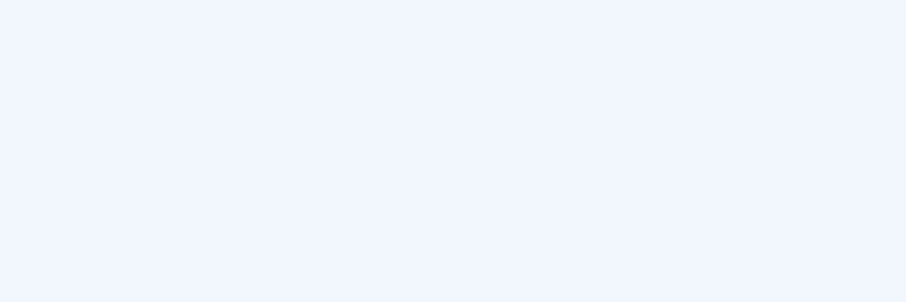
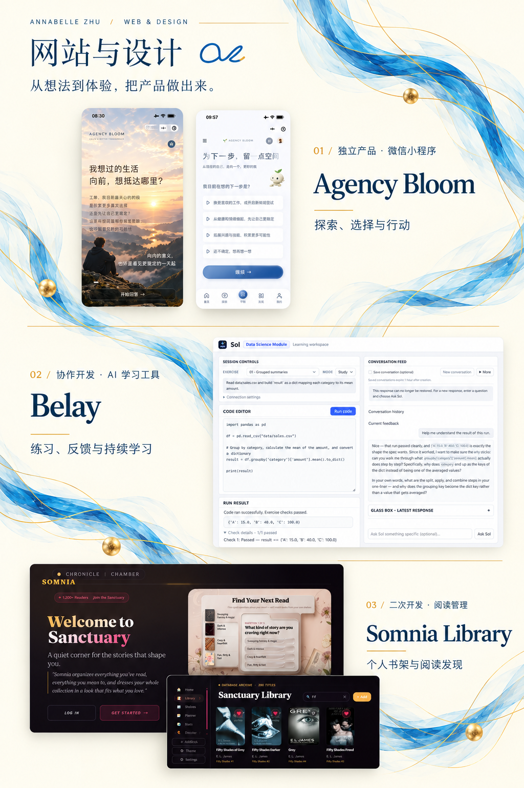
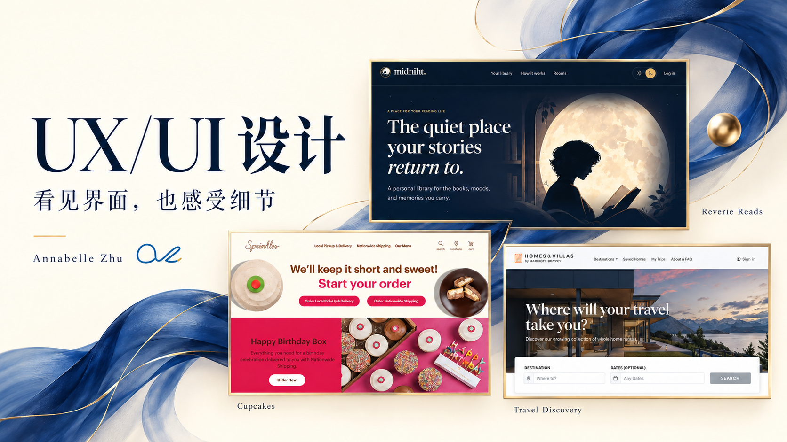
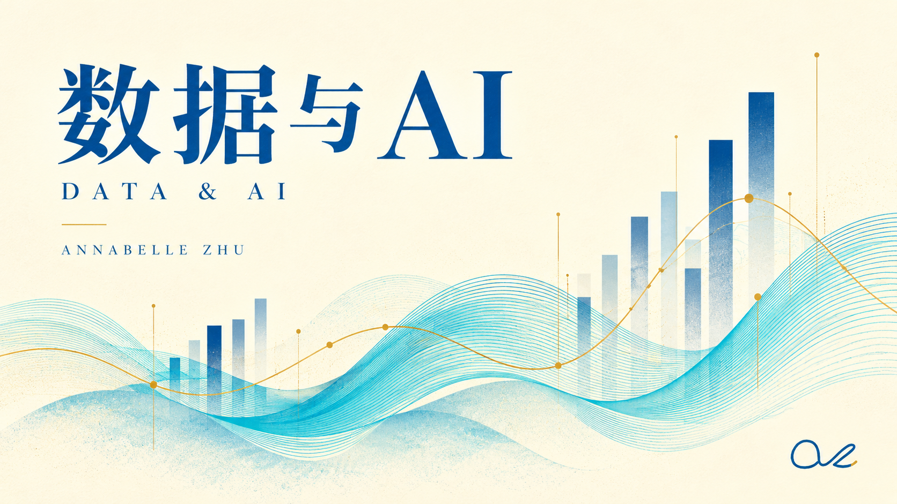
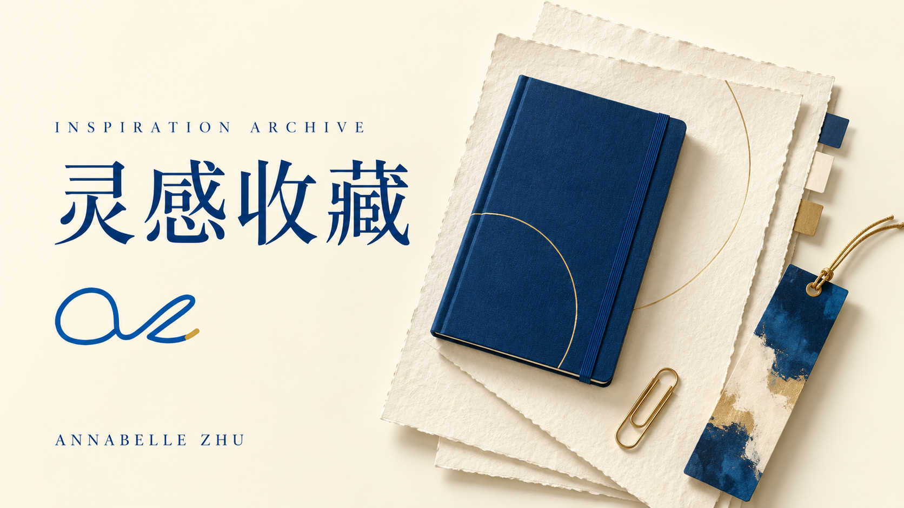
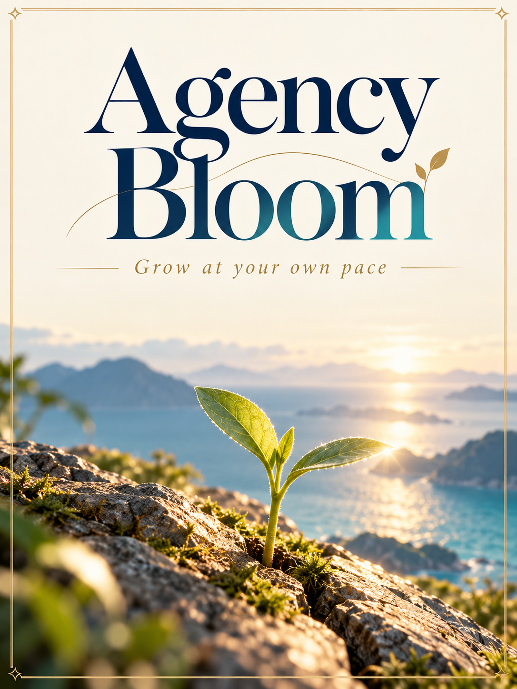
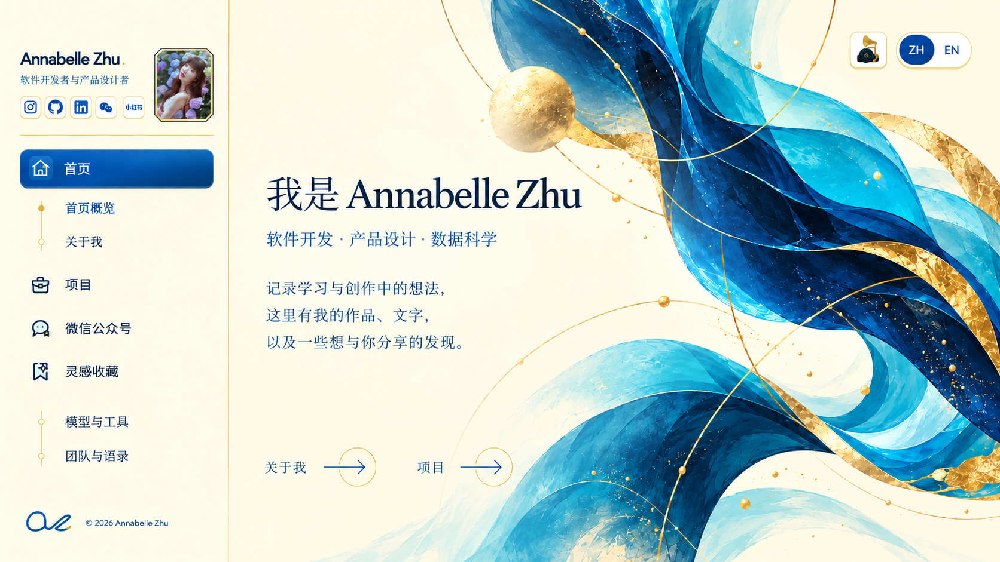

<p align="center">
  <a href="https://annabelle0726.github.io/Annabelle-portfolio/#hero"></a>
</p>

<h1 align="center">Annabelle Zhu</h1>
<p align="center"><strong>Software development · Product design · Data science</strong></p>
<p align="center">A space for my work, writing, and discoveries from learning and creating.</p>
<p align="center"><strong>English</strong> · <a href="README.zh-CN.md">简体中文</a></p>
<p align="center"><a href="https://annabelle0726.github.io/Annabelle-portfolio/">Explore the portfolio ↗</a> · <a href="#selected-work">Selected work</a> · <a href="#run-locally">Run locally</a> · <a href="#get-in-touch">Get in touch</a></p>

<p align="center">
  
  
  
  
</p>

This is the source for my personal portfolio: a place to explore the products I build, the interfaces I work on, and the questions I investigate through data. It also brings together my writing, reading notes, and the tools I use along the way.

The site pairs sapphire blue, turquoise, and champagne gold with a warm paper background. Sidebar navigation opens individual content views, with Chinese and English available across the main portfolio pages. WeChat articles retain their Chinese originals.

## Selected work

### 01 / Web & design

<p align="center">
  <a href="https://annabelle0726.github.io/Annabelle-portfolio/#portfolio"></a>
</p>

**[Agency Bloom](https://annabelle0726.github.io/Annabelle-portfolio/#web-agency-bloom)** — An independent WeChat mini program for exploring possibilities, considering choices, and taking a next step. My work spans product conception, interaction design, front-end and back-end development, and iteration. The case study includes interface details and a product demo.

**[Belay](https://annabelle0726.github.io/Annabelle-portfolio/#web-belay)** — A collaborative AI learning tool. My contributions cover interface work, saving and restoring conversations, and access and budget management. The portfolio shows the Sol data-science learning workspace and its feedback flow.

**[Somnia Library](https://annabelle0726.github.io/Annabelle-portfolio/#web-somnia)** — A reading-management application developed from Reverie. My work focuses on the home and book interfaces, authentication experience, and mobile navigation.

### 02 / UX/UI design

<p align="center">
  <a href="https://annabelle0726.github.io/Annabelle-portfolio/#XD"></a>
</p>

- **Cupcakes** — Web interactions centered on a daily-flavor reveal and clear visual feedback, using Sprinkles brand and product materials.
- **Reverie Reads / Midniht** — Collaborative development support and focused improvements. The displayed screens provide the wider product context; they do not imply sole authorship.
- **Travel Discovery** — A course prototype exploring destination cards and preference selection, using Marriott Homes & Villas materials. It is not commissioned work for Marriott.

[Explore the interface studies →](https://annabelle0726.github.io/Annabelle-portfolio/#XD)

### 03 / Data & AI

<p align="center">
  <a href="https://annabelle0726.github.io/Annabelle-portfolio/#services"></a>
</p>

- **AtHub anomaly detection** — Financial time-series exploration with Python, scikit-learn, SHAP, and Quarto; model comparison, interpretation, and the limits of prediction.
- **Public data visualization** — Visual stories about trade, environmental records, and occupational safety, built with R and visualization libraries.
- **Sustainable data-center siting** — An analysis of energy, cost, and regional constraints using SQL, Tableau, and GIS.

[Read the project context and original analyses →](https://annabelle0726.github.io/Annabelle-portfolio/#services)

## Writing & inspiration

<p align="center">
  <a href="https://annabelle0726.github.io/Annabelle-portfolio/#models"></a>
</p>

I keep articles, tools, and ideas that make me stop and think. The archive includes how I use ChatGPT and Claude Code, a selection of working methods and skills, and reading notes that separate what I have learned from what I still want to test.

[Models & tools](https://annabelle0726.github.io/Annabelle-portfolio/#models) · [Teams & quotes](https://annabelle0726.github.io/Annabelle-portfolio/#quotes) · [Reading notes](https://annabelle0726.github.io/Annabelle-portfolio/#notes-felix)

<details>
<summary><strong>Agency Bloom · Grow at your own pace</strong></summary>

<p align="center">
  <a href="https://annabelle0726.github.io/Annabelle-portfolio/#agency-bloom"></a>
</p>

The essays behind Agency Bloom explore choice, personal agency, and making room for a life of our own.

[Read the Chinese essays →](https://annabelle0726.github.io/Annabelle-portfolio/#agency-bloom)

</details>

*The gallery uses supplied presentation artwork. Open the portfolio for the current interfaces, project descriptions, and interaction demos.*

<p align="center">
  <a href="https://annabelle0726.github.io/Annabelle-portfolio/#hero"></a>
</p>

## Run locally

Use **Node.js 20.19+ in the 20.x series, or Node.js 22.12+**.

```bash
git clone https://github.com/Annabelle0726/Annabelle-portfolio.git
cd Annabelle-portfolio
npm install
npm run dev
```

Open the URL printed by Vite. For a phone on the same network:

```bash
npm run dev -- --host 0.0.0.0
```

Use the computer's LAN address and the port printed in the terminal.

## Build & publish

```bash
npm run build
npm run preview
```

The build compiles the React site and copies linked static portfolio examples into `dist/`. Deploy the **complete build output**, not the development `index.html`. Relative asset paths support hosting under a subdirectory.

The repository includes a [GitHub Pages workflow](.github/workflows/deploy.yml) triggered by pushes to `main` or a manual run. It installs dependencies, builds the site, and deploys `dist/`.

<details>
<summary><strong>Inside the repository</strong></summary>

```text
src/
  App.jsx               Content views and application shell
  navigation.js         Hash routes and view mapping
  sections/             Portfolio pages and project case studies
  components/           Navigation, artwork, previews and shared UI
  theme.css             Shared color tokens
assets/readme/          Presentation artwork for both READMEs
scripts/copy-static.mjs Static-example packaging
docs/                   Project and visual guidance
```

The main site uses React and Vite. Linked historical examples remain independent static pages. Some external project materials may require access from their original hosting service.

</details>

## Get in touch

<p align="center">
  <a href="https://annabelle0726.github.io/Annabelle-portfolio/#contact"></a>
</p>

For work opportunities, collaboration, or an interesting idea to share:

**[0realannabelle0@gmail.com](mailto:0realannabelle0@gmail.com)**

[GitHub](https://github.com/Annabelle0726) · [LinkedIn](https://www.linkedin.com/in/huizhu0726/) · [More ways to connect](https://annabelle0726.github.io/Annabelle-portfolio/#contact)

<sub>Third-party brands, project materials, fonts, and icons retain their respective ownership and license terms. Their appearance here does not imply endorsement. See the license and attribution files included with individual assets.</sub>
