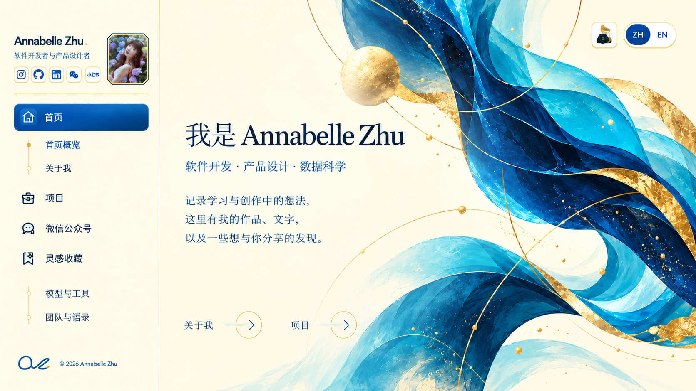
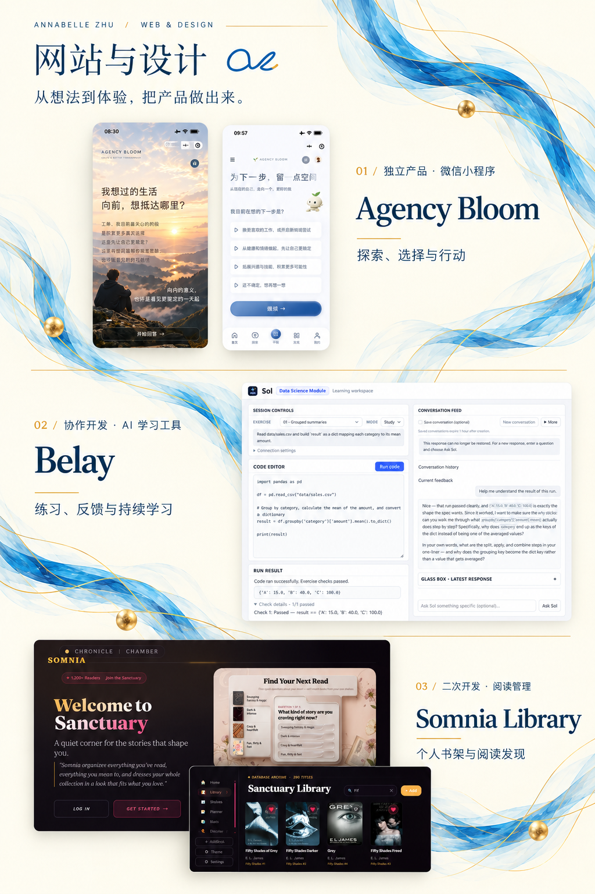
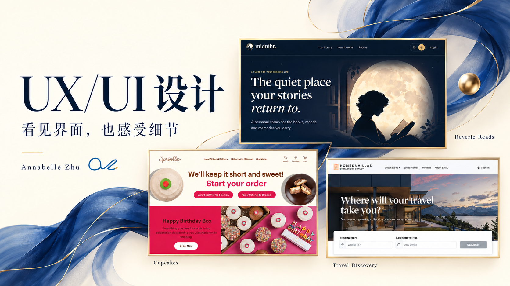
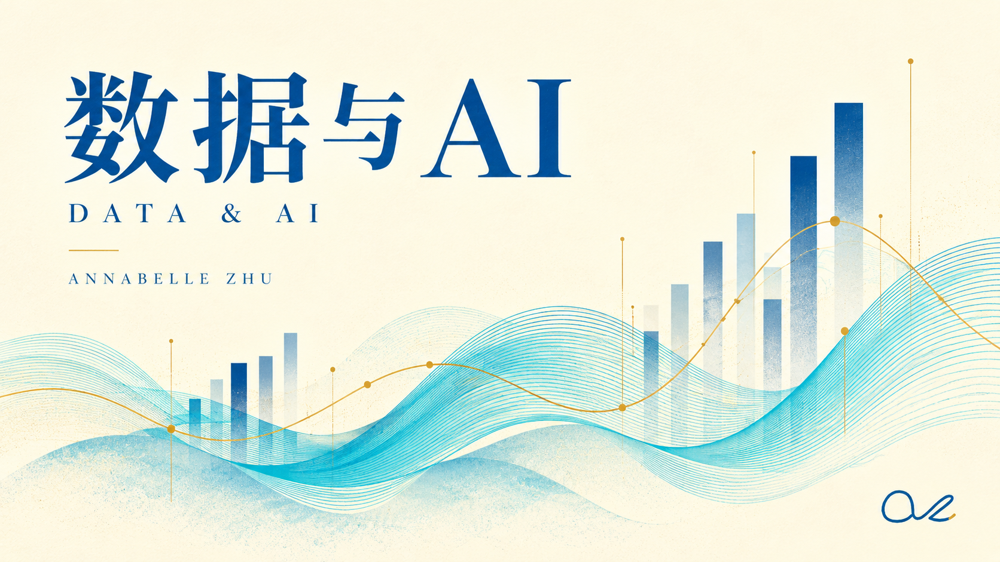
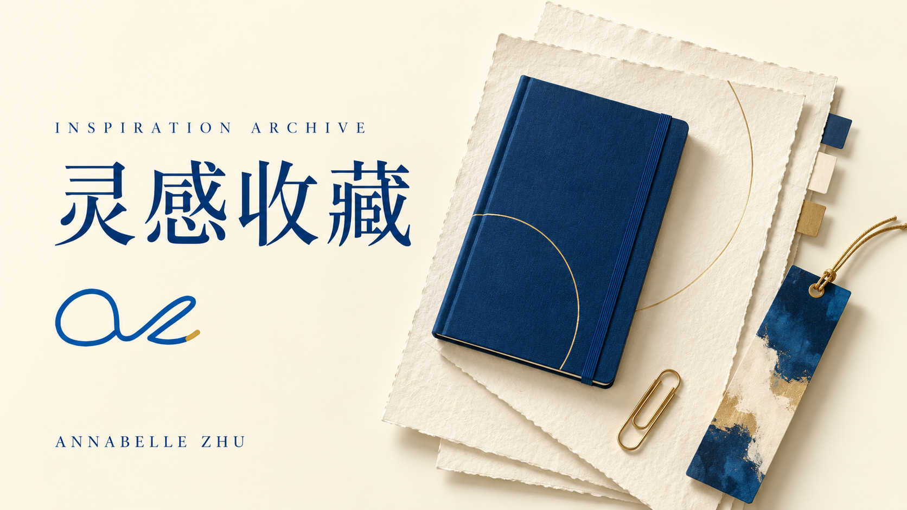
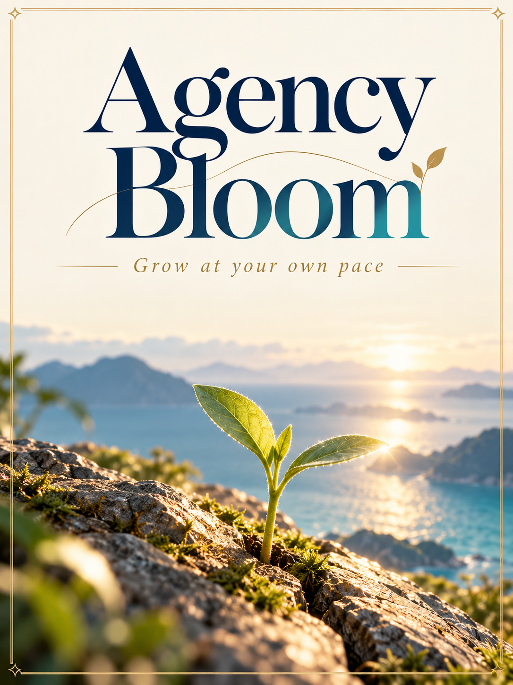

<p align="center">
  <a href="https://annabelle0726.github.io/Annabelle-portfolio/#hero"></a>
</p>

<h1 align="center">Annabelle Zhu</h1>
<p align="center"><strong>软件开发 · 产品设计 · 数据科学</strong></p>
<p align="center">记录学习与创作中的想法，这里有我的作品、文字，以及一些想与你分享的发现。</p>
<p align="center"><a href="README.md">English</a> · <strong>简体中文</strong></p>
<p align="center"><a href="https://annabelle0726.github.io/Annabelle-portfolio/">访问作品集 ↗</a> · <a href="#精选作品">精选作品</a> · <a href="#本地运行">本地运行</a> · <a href="#联系我">联系我</a></p>

<p align="center">
  
  
  
  
</p>

这是我的个人作品集网站源码。这里收录了我开发的产品、参与的界面设计，以及通过数据探索的问题，也整理了我的写作、阅读笔记和日常使用的工具。

网站以宝石蓝、湖水青和香槟金搭配暖纸色背景，通过侧栏进入不同内容视图。主要作品集页面提供中英文切换，公众号文章保留中文原文。

## 精选作品

### 01 / 网站与设计

<p align="center">
  <a href="https://annabelle0726.github.io/Annabelle-portfolio/#portfolio"></a>
</p>

**[Agency Bloom](https://annabelle0726.github.io/Annabelle-portfolio/#web-agency-bloom)** — 独立开发的微信小程序，围绕探索、选择与行动，帮助人们梳理想法、比较可能，并迈出下一步。我的工作覆盖产品构思、交互设计、前后端开发与持续迭代。项目介绍包含界面细节和产品演示。

**[Belay](https://annabelle0726.github.io/Annabelle-portfolio/#web-belay)** — 协作开发的 AI 学习工具。我参与界面、会话保存与恢复，以及访问和预算管理。作品集展示了 Sol 数据科学学习工作区及其反馈流程。

**[Somnia Library](https://annabelle0726.github.io/Annabelle-portfolio/#web-somnia)** — 基于 Reverie 二次开发的阅读管理应用。我的工作集中在首页与书籍界面、认证体验和移动端导航。

### 02 / UX/UI 设计

<p align="center">
  <a href="https://annabelle0726.github.io/Annabelle-portfolio/#XD"></a>
</p>

- **Cupcakes** — 参与网页交互实现，重点是「今日口味」的点击揭晓与状态反馈；使用 Sprinkles 品牌及产品素材。
- **Reverie Reads / Midniht** — 以协作形式参与开发支持和局部改进。展示的界面用于说明产品整体场景，不代表全部由我独立完成。
- **Travel Discovery** — 围绕目的地卡片和偏好选择展开的课程原型，使用 Marriott Homes & Villas 素材，非 Marriott 委托项目。

[查看界面与交互案例 →](https://annabelle0726.github.io/Annabelle-portfolio/#XD)

### 03 / 数据与 AI

<p align="center">
  <a href="https://annabelle0726.github.io/Annabelle-portfolio/#services"></a>
</p>

- **AtHub 异常检测** — 使用 Python、scikit-learn、SHAP 与 Quarto 探索金融时间序列，比较模型表现、解释特征贡献，并审视预测的边界。
- **公共数据可视化** — 使用 R 及可视化工具，将贸易、环境记录与职业安全数据组织成可阅读的趋势和关系。
- **可持续数据中心选址** — 使用 SQL、Tableau 与 GIS，分析能源、成本和地域条件之间的取舍。

[了解项目背景与原始分析 →](https://annabelle0726.github.io/Annabelle-portfolio/#services)

## 写作与灵感

<p align="center">
  <a href="https://annabelle0726.github.io/Annabelle-portfolio/#models"></a>
</p>

我会留下让我停下来思考的文章、工具与想法。这里包括我使用 ChatGPT 和 Claude Code 的方式、常用的方法与 Skills，以及阅读中的理解、疑问和想亲自验证的事情。

[模型与工具](https://annabelle0726.github.io/Annabelle-portfolio/#models) · [团队与语录](https://annabelle0726.github.io/Annabelle-portfolio/#quotes) · [阅读笔记](https://annabelle0726.github.io/Annabelle-portfolio/#notes-felix)

<details>
<summary><strong>Agency Bloom · 按照自己的节奏，慢慢生长</strong></summary>

<p align="center">
  <a href="https://annabelle0726.github.io/Annabelle-portfolio/#agency-bloom"></a>
</p>

围绕选择、自主性与生活方向，记录 Agency Bloom 背后的思考。

[阅读公众号文章 →](https://annabelle0726.github.io/Annabelle-portfolio/#agency-bloom)

</details>

*以上配图为作品集展示素材。当前界面、项目说明与交互演示，请进入网站查看。*

## 本地运行

使用 **Node.js 20.x 中的 20.19 及以上版本，或 Node.js 22.12 及以上版本**。

```bash
git clone https://github.com/Annabelle0726/Annabelle-portfolio.git
cd Annabelle-portfolio
npm install
npm run dev
```

打开 Vite 在终端中显示的地址。如需在同一网络下用手机查看：

```bash
npm run dev -- --host 0.0.0.0
```

在手机浏览器中使用电脑的局域网 IP 和终端显示的端口。

## 构建与发布

```bash
npm run build
npm run preview
```

构建会编译 React 主站，并将关联的独立静态作品复制到 `dist/`。部署时上传 **完整构建产物**，不能直接使用开发目录中的 `index.html`。资源采用相对路径，支持部署在子目录下。

仓库已有 [GitHub Pages 发布流程](.github/workflows/deploy.yml)，推送到 `main` 或手动触发时，会安装依赖、构建网站并部署 `dist/`。

<details>
<summary><strong>仓库结构</strong></summary>

```text
src/
  App.jsx               内容视图与应用框架
  navigation.js         Hash 路由与视图映射
  sections/             作品集页面与项目案例
  components/           导航、视觉素材、预览与共享组件
  theme.css             共享颜色变量
assets/readme/          中英文 README 使用的展示素材
scripts/copy-static.mjs 独立静态作品打包
docs/                   项目与视觉规范
```

主站使用 React 与 Vite。关联的历史作品仍保留为独立静态页面，部分外部项目材料可能需要原托管服务的访问权限。

</details>

## 联系我

<p align="center">
  <a href="https://annabelle0726.github.io/Annabelle-portfolio/#contact"></a>
</p>

如果你想聊聊工作机会、合作，或分享有意思的想法，欢迎给我写邮件。

**[0realannabelle0@gmail.com](mailto:0realannabelle0@gmail.com)**

[GitHub](https://github.com/Annabelle0726) · [LinkedIn](https://www.linkedin.com/in/huizhu0726/) · [更多联系方式](https://annabelle0726.github.io/Annabelle-portfolio/#contact)

<sub>第三方品牌、项目素材、字体与图标保留各自的权属及许可条件；在此展示不代表品牌背书。相关说明请参见各素材随附的许可和署名文件。</sub>
